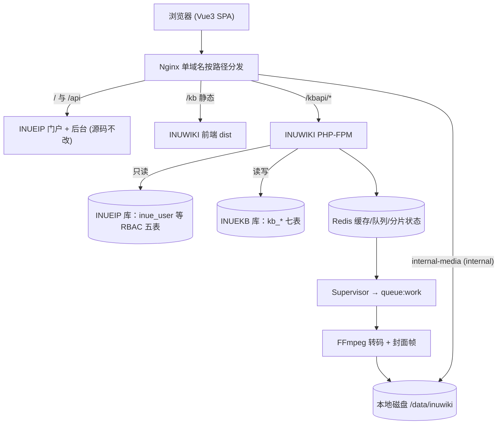

# INUWIKI 知识库 · 技术方案

> 独立知识库项目（`h:/XAMPP/htdocs/INUWIKI/`），账号密码与 RBAC 权限复用 EIP（`INUEIP/`）。
> 支持图文与大视频（100MB–1GB，分片上传 + 断点续传 + 正文内嵌播放）。
> 核心新增「**空间**」维度：受限空间仅授权成员可见且不参与全站统计。
> 会话**当天有效**；存储本地磁盘；目标承载 100 人同时操作（峰值并发 60–100）。

---

## 1. 核心决策记录

| 决策项 | 结论 |
|---|---|
| 项目形态 | **独立新项目 `INUWIKI/`**，不改动 `INUEIP/` 任何源码 |
| 技术栈 | PHP 8.2 + ThinkPHP 8.1（与 EIP 同构）；前端 Vue3 + Vite5 + Element Plus + Tailwind 3 |
| 账号 | 复用 EIP `inue_user`（bcrypt），**知识库不自建用户表**，用户在 EIP 后台统一配置 |
| 密码 | 只维护一份（`inue_user.password_hash`） |
| 权限 | 角色与权限码从 EIP RBAC 五表**只读**获取；`kb:*` 权限点注册进 `inue_permission`，在 EIP 后台分配 |
| 登录入口 | **INUWIKI 自带登录页**，账密直查 `inue_user` 校验（可不经 EIP 直接使用） |
| 会话 | **当天有效**（签发起至当日 24:00），**无滑动续期**；禁用账号即时生效 |
| 数据库 | **双连接**：只读连 `INUEIP`（用户/权限）+ 读写连 `INUEKB`（内容） |
| 空间 | 公开 / 受限两类；授权粒度 **按角色 + 按人**；未授权**完全隐藏**；**统计口径 A** |
| 单篇权限 | 可见范围（公开/空间内/指定范围）+ 可编辑范围（所有人可改 / 指定人·角色）；粒度 **角色 + 人** |
| 默认创建权 | **公开空间人人可创建**（wiki 共建），受限空间仅授权成员；管理员可用 RBAC 收紧 |
| 上传 | 沿用 EIP 实现约定（配置驱动 / 相对路径 / `_tmp` 暂存 / 回收站 GC）；**新增 `finfo` MIME 嗅探** |
| 部署 | Ubuntu 22.04 + Nginx + PHP-FPM + OPcache + Redis；单域名按路径分发 |
| 存储 | 本地磁盘 `/data/inuwiki`（建议独立挂载） |

**明确不做**：JWT 跨系统共享、令牌内省接口、`/api/auth/refresh`、滑动续期、知识库侧 user/role/permission 表。

---

## 2. 总体架构



**关键设计：**

1. **视频字节不经 PHP**：鉴权后返回 `X-Accel-Redirect`，Nginx `internal` location 用 `sendfile` 直发，原生支持 Range(206) 拖拽播放。60–100 并发下 PHP-FPM 不被打爆的**唯一决定性设计**。
2. **分片上传规避 PHP 上传限制**：5MB/片，`upload_max_filesize=8M`、`post_max_size=10M` 即可。
3. **空间权限前置过滤**：所有列表/搜索/统计/推荐先取"可见空间集合"再查，避免逐条鉴权与越权泄漏。
4. **配置只写 `backend/config/myconfig.php`**，遵守统一配置规范；`database`/`jwt` 禁止下发前端。

---

## 3. 账号与权限

### 3.1 登录

```
POST /kbapi/auth/login  {username, password}
  1. 查 INUEIP.inue_user（username 唯一索引）
  2. password_verify($password, $user->password_hash)      ← bcrypt，与 EIP 同语言无坑
  3. 校验 status === 1（禁用即拒绝，与 EIP AuthCheck.php:27-30 行为一致）
  4. 自实现失败锁定：5 次 / 15 分钟（EIP 的 file 缓存计数不跨项目共享）
  5. 签发 INUWIKI 自己的 JWT（独立密钥，有效期至当日 24:00）
```

### 3.2 权限读取

照搬 EIP `AuthService::buildProfile()`（`INUEIP/backend/app/service/AuthService.php:77-107`）：

- 取用户角色 `user_role → role`；
- `role.code === 'super_admin'` → 全部权限；
- 否则聚合 `role_permission → permission.code`（跳过 `status !== 1` 的角色），去重。

中间件按权限码判断，如 `in_array('kb:article:create', $permissions)`。

### 3.3 需写入 EIP 库的数据（唯一涉及 EIP 的改动，非源码）

经 INUWIKI 迁移脚本向 `INUEIP.inue_permission` 插入：

```
kb:article:list / kb:article:create / kb:article:update / kb:article:delete / kb:article:publish
kb:category:manage / kb:space:manage / kb:media:upload
```

---

## 4. 空间管理

### 4.1 数据模型

```
kb_space         id, name, code, description, cover, is_restricted(0公开/1受限), status, sort, created_by, timestamps
kb_space_member  id, space_id, subject_type(user|role), subject_id, can_view, can_edit, can_manage, created_at
kb_category      id, space_id, parent_id, name, sort, status, timestamps
kb_article       id, space_id, category_id, ...（space_id 冗余便于权限过滤与统计）
```

### 4.2 可见性规则

- 公开空间（`is_restricted=0`）：所有登录用户可见。
- 受限空间（`is_restricted=1`）：仅 `kb_space_member` 中授权的角色或个人可见。
- **未授权 = 完全隐藏**：空间入口、其下分类页签、文章、搜索结果、相关推荐均不返回；接口不返回"存在但无权限"提示，避免信息泄漏。
- 超管（`super_admin`）绕过，与 `AuthService.php:81-84` 一致。
- 授权粒度：**角色 + 人**，权限取并集，三档 `can_view / can_edit / can_manage`。

### 4.3 统计口径 A（用户确认）

- 全站统计（总条目数、视频数、热门榜、首页数字、相关推荐）**排除受限空间**。
- 受限空间**内部仍保留自身浏览统计**，授权成员进入可见。
- 实现：全站聚合 SQL 以"可见空间集合"为作用域，避免事后过滤导致的计数偏差。

---

## 5. 文章与单篇权限

```
kb_article.view_scope   public | space | restricted
kb_article.edit_mode    open(所有人可改) | restricted(指定人·角色可改)
kb_article_editor       id, article_id, subject_type(user|role), subject_id
```

**编辑权限判定顺序：**

```
超管(super_admin)
 → 空间管理员(space_member.can_manage)
 → 空间成员(can_edit)
 → edit_mode=open 且具 kb:article:update
 → 命中 kb_article_editor（user 直配 或 用户所属 role）
```

- 授权粒度：**角色 + 人**。
- 默认：公开空间人人可创建（wiki 共建）；受限空间仅授权成员可写。

---

## 6. 正文内插入视频 / 附件

- wangEditor 增加菜单「插入视频」「插入附件」，**在光标处**插入占位节点：
  - `<div data-kb-video="12"></div>`
  - `<a data-kb-file="34">入职材料清单.pdf</a>`
- 前端渲染正文时替换为真实播放器 / 附件卡片。
- **HTMLPurifier 必须白名单放行** `div[data-kb-video]`、`a[data-kb-file]`，否则节点会被 XSS 过滤掉（复用 EIP `PurifierService.php` 的配置思路）。
- 两个入口并存：正文任意段落插入 + 文末统一附件列表（自动汇总本文附件）。

---

## 7. 上传与媒体流水线

### 7.1 沿用 EIP 的实现约定

| EIP 现有约定 | INUWIKI 沿用 |
|---|---|
| 参数只在 `myconfig.php` 的 `upload` 组（`myconfig.php:75-81`） | ✅ 同结构 |
| 每模块 `upload_prefix` + `remote_base_url`（`myconfig.php:83-94`） | ✅ 新增 `knowledge.upload_prefix` |
| 目录由 `upload_dir($group, $subDir)` 解析（`common.php:39-51`） | ✅ 同名 helper |
| **DB 只存相对路径**，展示时拼前缀 | ✅ 完全一致 |
| `_tmp` 暂存 + `move_to_trash()` + `gc_trash()`（`common.php:117-232`） | ✅ 复用，GC 命令照 `SkillGc.php` |
| 校验 `validate(['file'=>'fileExt:...\|fileSize:...'])`（`admin/Announcement.php:184-190`） | ✅ 图片一致 |
| **新增**：`finfo` MIME 嗅探（用户确认） | ✅ 扩展名与真实类型双白名单比对，不一致即拒 |

### 7.2 分片上传 API

| 接口 | 方法 | 说明 |
|---|---|---|
| `/kbapi/admin/kb/uploads/init` | POST | 返回 `uploadId`（服务端生成，避免浏览器算 1GB 全量哈希卡主线程） |
| `/kbapi/admin/kb/uploads/check` | GET | 扫描分片目录返回 `uploaded:[0,1,2…]` |
| `/kbapi/admin/kb/uploads/chunk` | POST | 单片 5MB → `_tmp/{uploadId}/{index}.part` |
| `/kbapi/admin/kb/uploads/complete` | POST | 校验齐全 → 建 attachment(pending) → **入队**，立即返回 |
| `/kbapi/kb/articles/:id/media/:attachmentId` | GET | 鉴权 → `X-Accel-Redirect: /internal-media/…` |

**要点**：合并流式（`fopen/fread(8192)/fwrite`，禁 `file_get_contents`）；`realpath` 越界校验；续传键用 `文件名+大小+lastModified` 存 localStorage。

### 7.3 转码与播放

- 队列 `topthink/think-queue`（Redis）+ Supervisor，并发 1–2 路防 CPU 打满。
- FFmpeg：H.264/AAC + `-movflags +faststart` + 720p + 封面帧。
- 状态机：`pending → merging → transcoding → ready / failed`（失败写 `fail_reason`，支持重试）。
- 播放：Nginx `location /internal-media { internal; sendfile on; }`，原生 Range(206)。

---

## 8. 页面结构

| 页面 | 说明 |
|---|---|
| 门户 · WIKI 列表 | 顶栏仅「首页 / WIKI」；空间切换器（受限空间带锁）+ 分类树 + 卡片列表；英雄区标注统计口径 |
| 门户 · WIKI 详情 | 面包屑含空间；正文内嵌播放器与附件卡片；左侧目录；文末附件列表；相关推荐受可见空间约束 |
| 后台 · 知识管理 | 空间列表 + 分类树；文章表格含**可见范围**列；页脚存储容量与转码队列 |
| 后台 · 文章编辑 | **「设置」「正文」两页签**；设置含标题/空间/分类/封面/摘要/发布设置/可见范围/可编辑范围；正文编辑器占满整行，下方依次为视频面板与附件 |
| 后台 · 空间管理 | 空间卡片（公开/受限、篇数、成员数）+ 成员授权（按角色 / 按人员并存，查看/编辑/管理三档） |

原型：`INUWIKI/prototype/`，截图 `INUWIKI/prototype/screenshots/`。

---

## 9. 部署与验收

| 组件 | 要点 |
|---|---|
| Nginx | 路径分发；`/internal-media` 设 `internal`；`client_max_body_size 12m`；uploads 禁 PHP 执行 + `nosniff` |
| PHP-FPM 8.2 | `pm.max_children=80`、`pm.max_requests=1000` |
| OPcache | `enable=1`、`memory_consumption=256`、`validate_timestamps=0`（**发版须 `php-fpm reload`**） |
| Redis / FFmpeg / Supervisor | 缓存+队列；`apt install ffmpeg`；守护 `queue:work` |

**容量**：单视频上限 1GB，50 个即 50GB；后台展示已用容量，转码降码率 + 回收站定期清理。
**带宽**：60 人 × 2Mbps ≈ 120Mbps，需确认内网带宽；不足时启用预留的 `resource.mode=cdn`。

**压测验收**：60/80/100 三档，API P95 < 500ms、错误率 < 0.5%；30 路并发播放期间其余 API P95 劣化 ≤ 20%，观察 `pm.status_path` 确认 PHP-FPM worker 不被占用。

---

## 10. 风险与待办

1. 磁盘容量是最大现实约束，需容量可视化与超限告警。
2. 转码耗时长，需限制并发并允许"后台继续"。
3. EIP 数据库故障会导致 INUWIKI 无法登录/鉴权（直连方案固有），内网同机房部署可接受。
4. 多实例部署时失败锁定计数需切 Redis（配置已预留）。
